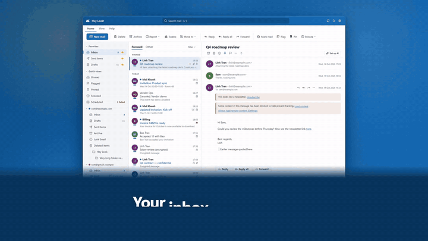

# Hey Look!

A desktop mail client for Windows, macOS and Linux. Free and open source, with no ads, no analytics and no account to create.

[](https://heylook.namthai.site/#film)

**Website:** https://heylook.namthai.site/ · [Download](https://heylook.namthai.site/download.html) · [Help and FAQ](https://heylook.namthai.site/help.html)

## Download

Get the latest version from the [download page](https://heylook.namthai.site/download.html) or from [GitHub Releases](https://github.com/thnonl/hey-look/releases/latest):

- Windows 10 and 11, 64-bit: `.exe` installer (recommended) or `.msi` (for managed installs)
- macOS 11 or later, Apple silicon and Intel: `.dmg` (one universal app)
- Linux: `.AppImage` (any distro), `.deb` (Debian, Ubuntu) or `.rpm` (Fedora, openSUSE)

A copy from the website or GitHub updates itself after you agree, and only a correctly signed update is installed.

On Windows you can also get Hey Look! from the [Microsoft Store](https://apps.microsoft.com/store/detail/9NS9H9T204HD?cid=DevShareMCLPCS). The Store copy has no updater of its own: the Store installs and updates it. Each release reaches the Store after Microsoft has approved it, so the Store can be a little behind GitHub. The Store copy keeps its own mail, accounts and settings, so use either the Store copy or the website copy on a computer, not both.

The APT repository and the Snap Store are not available yet (see [PACKAGING.md](PACKAGING.md)).

The installers are not code-signed with a publisher certificate, and the macOS app is self-signed but not notarized, so the first start needs one extra step: see [First start on macOS](https://heylook.namthai.site/download.html#install-notes) and the [Help](https://heylook.namthai.site/help.html#g-install) for Windows and Linux.

## What it does

- Many mailboxes in one place: Google and Microsoft, iCloud, Yahoo and any IMAP/SMTP server, with push for new mail where the server supports it. Test connection checks a new account's servers before you add it and says which setting to fix
- An Outlook-like editor, undo send, send later, snooze, rules, signatures and templates, and a window of its own for writing or reading
- Pictures in mail stay hidden until you allow them, so tracking pixels stay blocked. They show without a click only in mail from people you have written to and from well-known services, and only when the message passes the sender check (DMARC or a matching DKIM signature); an info button in the message header says why, and "Stop showing pictures from this sender" turns it off for that address. In Settings you can turn the automatic rule off, see the senders you turned off and view the list of services
- A local calendar for invitations, with optional two-way sync with Google Calendar, Outlook / Microsoft 365 and CalDAV calendars (iCloud, Fastmail, Nextcloud and others)
- OpenPGP encryption and signing, and Confidential mail that cannot be copied or printed (and, on Windows and macOS, not captured on screen)
- An optional AI Assistant that uses an OpenAI-compatible service and key that you set up yourself, and sends text only when you press a button
- Eight languages: English, Tiếng Việt, Français, 中文（简体）, Español, 日本語, Deutsch and Русский; light and dark themes

There is no Hey Look! server in the middle: the app talks straight to your mail provider. Copies of your mail stay on your computer, and passwords and sign-in tokens are kept in your system's credential store. Every feature and its known limits: [Features](https://heylook.namthai.site/features.html) and [Known limitations](https://heylook.namthai.site/features.html#limits).

## Known notes

- macOS: the first time you print, macOS may ask whether Hey Look! may find devices on your local network. This lets the print window find your printers; Hey Look! uses the local network for nothing else.
- macOS: each pop-out window you close keeps a small empty system window, about 0.2 MB, until Hey Look! quits.
- Linux: the x86_64 packages (AppImage, .deb, .rpm) were not installed or tested.
- Not tested by the project’s QA for this version: real Google and Microsoft sign-in, real CalDAV servers (iCloud, Fastmail, Baikal, Nextcloud, Radicale; simulated servers were used), the blocking of screen capture for Confidential mail with the real tools (Windows Print Screen and Snipping Tool, macOS screenshots), Windows 10, Intel Macs and macOS 11 and 12. [TODO-QA-1011: replace this bracket with the test statement from the 1.0.11 QA reports: "The changes of 1.0.11 were tested on ..." (Windows, Mac and Linux machines, systems and builds exactly as the reports name them, and which steps used real input)]. The downloadable macOS app and the Linux packages (AppImage, .deb, .rpm) were not installed or tested. Windows 10, Intel Macs and macOS 11 and 12 are supported but were not tested on this release, and neither were real sign-in, audible sound, the system's own tooltips on Windows and touch input. If something fails for you, please [open an issue](https://github.com/thnonl/hey-look/issues).

## Documentation and support

- [Features](https://heylook.namthai.site/features.html) · [Help and FAQ](https://heylook.namthai.site/help.html) · [Download](https://heylook.namthai.site/download.html) · [Support the project](https://heylook.namthai.site/support.html)
- [Privacy policy](https://heylook.namthai.site/privacy.html) · [Terms of service](https://heylook.namthai.site/terms.html) · [Google API data use](https://heylook.namthai.site/google-data.html) · [Security](https://heylook.namthai.site/security.html)
- The website in [Tiếng Việt](https://heylook.namthai.site/vi/) · [Français](https://heylook.namthai.site/fr/) · [中文（简体）](https://heylook.namthai.site/zh/) · [Español](https://heylook.namthai.site/es/) · [日本語](https://heylook.namthai.site/ja/) · [Deutsch](https://heylook.namthai.site/de/) · [Русский](https://heylook.namthai.site/ru/)
- What changed: [CHANGELOG.md](CHANGELOG.md) and [GitHub Releases](https://github.com/thnonl/hey-look/releases)
- Bugs and ideas: [GitHub Issues](https://github.com/thnonl/hey-look/issues) (issues are public: never post mail, passwords or tokens)

Hey Look!'s use of information received from Google APIs adheres to the [Google API Services User Data Policy](https://developers.google.com/terms/api-services-user-data-policy), including the Limited Use requirements.

## Build from source

```bash
npm install
npm run tauri dev      # run the desktop app
npm run tauri build    # release build with installers
```

Prerequisites, sign-in clients, tests and the code layout: [CONTRIBUTING.md](CONTRIBUTING.md).

## Support the project

Hey Look! is free. If it helps you, you can [buy me a coffee](https://heylook.namthai.site/support.html) on Ko-fi; a star on GitHub, a bug report or a better translation helps too. The app may show a small reminder about once every two months; Settings > General > Occasional support reminder turns it off.

## Security

Please report vulnerabilities privately: see [SECURITY.md](SECURITY.md).

## License

MIT, free to use: see [LICENSE](LICENSE).

Third-party data and components: the emoji names and keywords come from the Unicode CLDR annotations (version 48.2.0), Copyright © 1991-2026 Unicode, Inc., used under the [Unicode License v3](https://www.unicode.org/license.txt); the PDF preview is PDF.js ([Apache-2.0](https://www.apache.org/licenses/LICENSE-2.0)) with its fonts and character maps, and its licences ship with the app. The interface font is [Inter](https://rsms.me/inter/) (variable, Latin, Cyrillic and Vietnamese subsets of the `@fontsource-variable/inter` package), Copyright © 2016 The Inter Project Authors, under the [SIL Open Font License 1.1](https://openfontlicense.org/); the licence text ships with the app (`public/fonts/OFL.txt`) and the font files are in `public/fonts/`.
